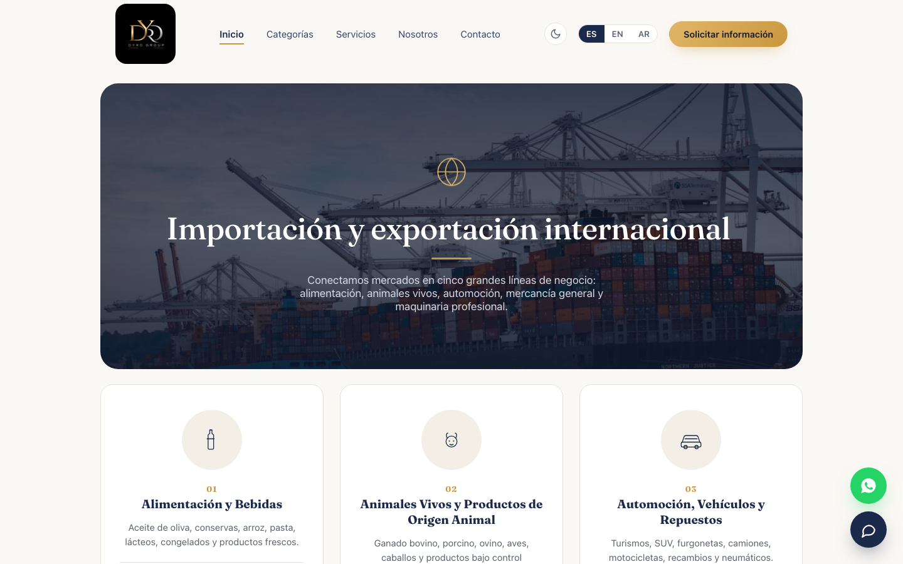
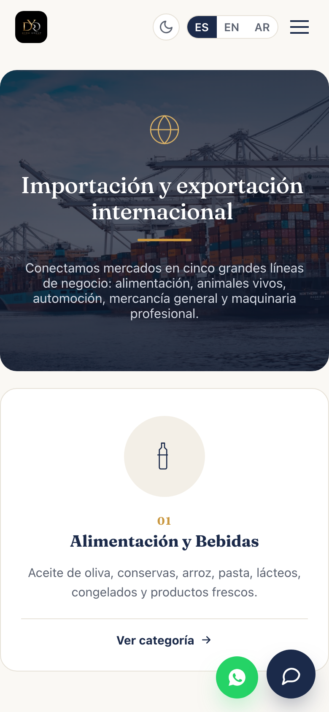

# DYRD Group · Web corporativa

Web de **DYRD Group**, empresa española de importación y exportación internacional (alimentación, animales vivos,
automoción, mercancía general y maquinaria profesional).

[**Ver la web → dyrdgroup.com**](https://dyrdgroup.com)

> Este repositorio es un **escaparate** del trabajo: enseña la web, no contiene su código.

## Qué tiene

- **Diseño premium y editorial**: azul marino, dorado y crema, con la tipografía Fraunces en los titulares.
- **Varios idiomas** (español, inglés y árabe) con un selector en la cabecera.
- **Modo oscuro** que se recuerda entre visitas.
- **Animaciones suaves**: apariciones al hacer scroll, tarjetas con inclinación 3D, subrayados que se dibujan, contadores
  animados y parallax en el inicio.
- **Una página por línea de negocio**: alimentación, animales, automoción, mercancía general y maquinaria.
- **Formulario de contacto** que llega por correo, y botón de WhatsApp.
- **Asistente de chat con IA** integrado ([Blanco AI](https://blancoai.app)) que responde dudas de los visitantes.
- **Pensada para el móvil** desde el principio.
- **Publicación automática**: cada cambio se sube solo al hosting.

  

## Cómo está hecha

HTML, CSS y JavaScript sin frameworks ni herramientas de compilación, formulario en PHP, despliegue automático con GitHub
Actions y alojamiento con HTTPS.

## Autor

Diseñada y desarrollada por **Carlos Melero** ([@bblanncooo](https://github.com/bblanncooo)), creador de
[Blanco AI](https://blancoai.app).

📧 Contacto: [jcmelero74@gmail.com](mailto:jcmelero74@gmail.com)

---

© 2026. Todos los derechos reservados. Las capturas y textos de este repositorio no se pueden reutilizar sin permiso.
